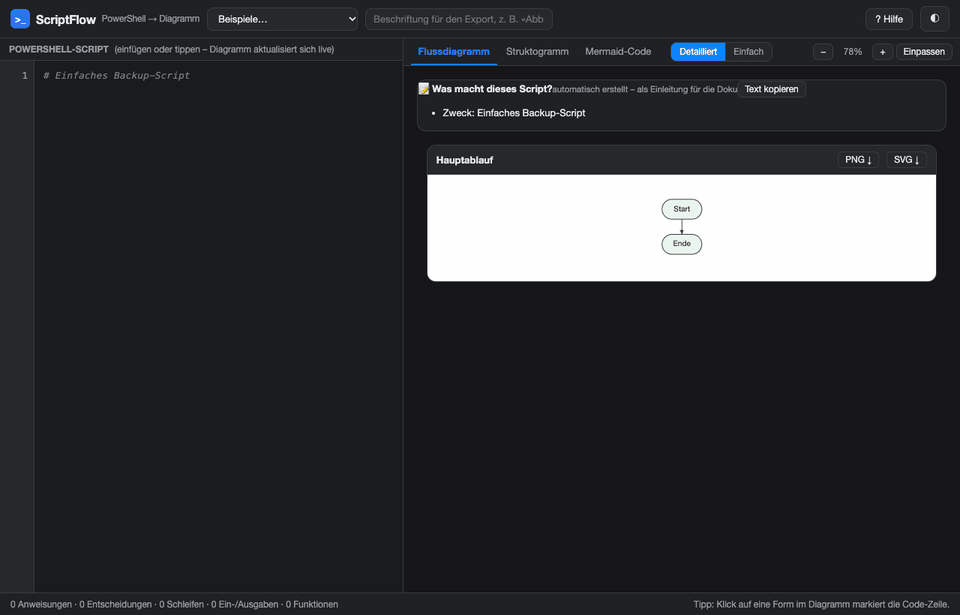
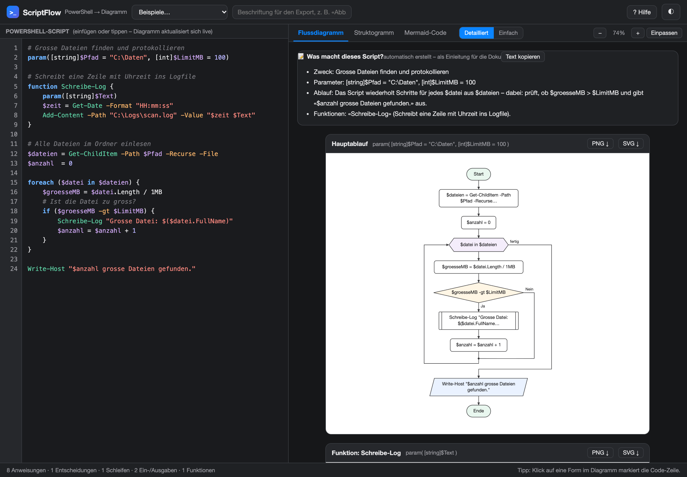
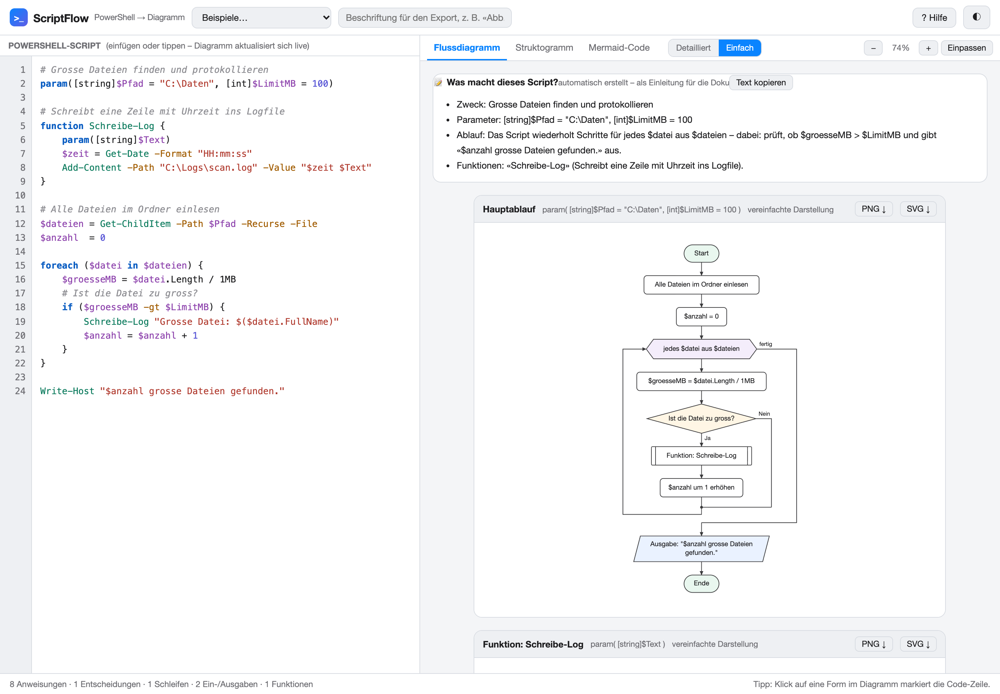
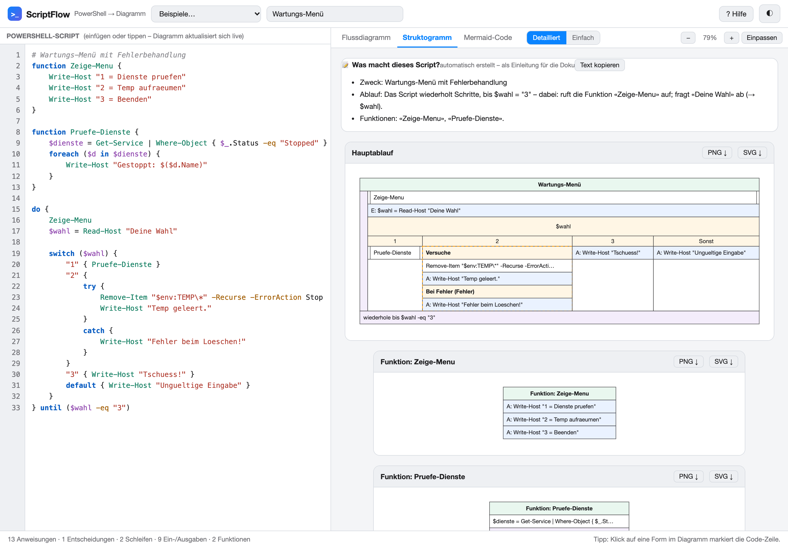
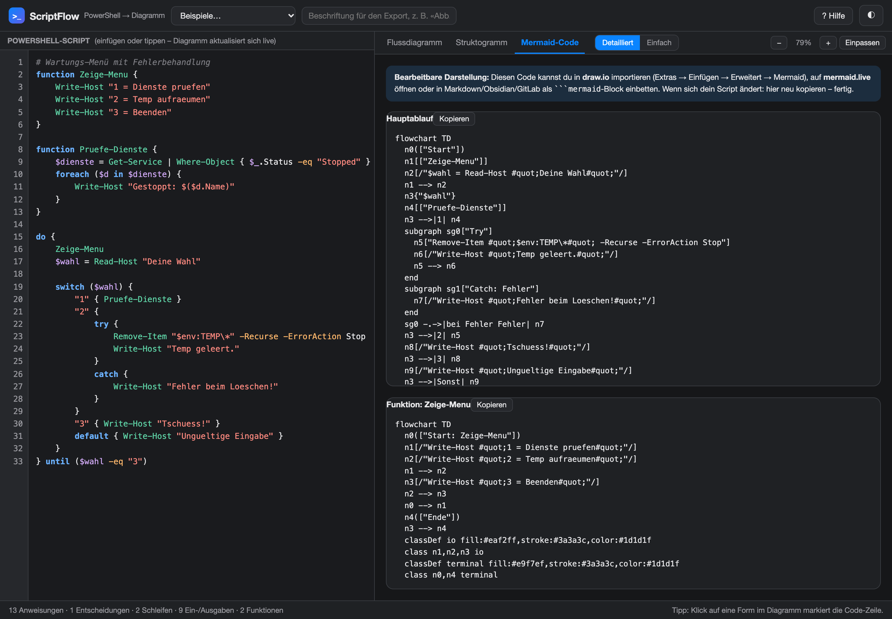

# ScriptFlow

Turns PowerShell scripts into DIN 66001 flowcharts, Nassi-Shneiderman diagrams and Mermaid code.
It runs entirely in the browser, works offline, has no dependencies and can be built into a single HTML file.

[Live demo](https://aralimnga.github.io/scriptflow/) ·
[Deutsch: LIESMICH.md](LIESMICH.md) ·
[Module contract: CONTRACT.md](CONTRACT.md)



> **Language note.** The interface and the diagram labels are in German (Swiss spelling: *Ja/Nein*, *Start/Ende*,
> *Sonst*, *fertig*). The tool was made for a scripting module at a Swiss vocational school, where PowerShell
> scripts have to be documented with flowcharts and Nassi-Shneiderman diagrams (*Struktogramme*).

## Features

- **Flowchart** in DIN 66001 style: terminators, process boxes, decision diamonds, I/O parallelograms
  (`Read-Host`, `Write-Host`, `Out-File`, `Export-Csv`, ...), hexagon loop headers with back edges, double-bar boxes
  for calls to functions defined in the same script, and dashed containers for `try`/`catch`.
- **Nassi-Shneiderman diagram**: the compact form without arrows that shows the nesting.
- **Mermaid code** (`flowchart TD`): the editable form. Paste it into draw.io (Arrange > Insert > Advanced >
  Mermaid), open it on mermaid.live or put it in a Markdown file as a `mermaid` code block.
- **Live update**: edit the script on the left and the diagram changes as you type. Clicking a shape highlights the
  matching line in the editor.
- **One diagram per function**, plus the main flow.
- **Two levels of detail.** *Detailliert* shows the real code. *Einfach* rewrites commands as plain German
  (`Read-Host "..."` becomes *Eingabe: ...*, `Get-ChildItem` becomes *Dateien auflisten*, `-gt` becomes `>`),
  merges consecutive outputs and uses a `#` comment directly above a statement as the label of its shape.
- **Automatic description**: a panel above the diagram summarises the purpose (from the header comment),
  parameters, flow and functions in full sentences, with a copy button for the documentation.
- **Export** as PNG (2x resolution, for Word or OneNote) and SVG, optionally with a caption such as
  *Abbildung 1: ...* drawn into the image. Diagrams always use a light, print-ready palette; the app itself has a
  dark and a light theme.
- **Tolerant parser**: comments and block comments, single- and double-quoted strings with `$( ... )`
  subexpressions, here-strings, backtick line continuation and pipelines are handled. Broken input such as a
  missing closing brace produces a warning in the status bar instead of an error.

Recognised statements: `if`/`elseif`/`else`, `switch` (including `default`), `while`, `do ... while`,
`do ... until`, `for`, `foreach`, `function` (with `param(...)`), `try`/`catch`/`finally`, and `return`, `break`,
`continue`, `exit`, `throw`.

## Screenshots

<table>
  <tr>
    <td width="50%"></td>
    <td width="50%"></td>
  </tr>
  <tr>
    <td><b>Flowchart, detailed.</b> The script on the left, the generated DIN 66001 flowchart and the automatic description on the right.</td>
    <td><b>Simple mode.</b> Comments become labels (<i>Ist die Datei zu gross?</i>) and commands are rewritten in plain German.</td>
  </tr>
  <tr>
    <td></td>
    <td></td>
  </tr>
  <tr>
    <td><b>Nassi-Shneiderman diagram</b> of a menu script with <code>do ... until</code>, <code>switch</code> and <code>try</code>/<code>catch</code>.</td>
    <td><b>Mermaid code</b> for the same script, ready to paste into draw.io or Markdown.</td>
  </tr>
</table>

The example scripts are built into the app (menu *Beispiele*).

## Getting started

Nothing to install and nothing to build:

- Open the [live demo](https://aralimnga.github.io/scriptflow/), or
- open `index.html` directly in a browser. It also works from `file://`, so you can copy the folder to a USB stick
  or a school PC, or
- run `node serve.js` and go to <http://localhost:8666> (on macOS, double-click `serve.command`).

**Single file.** `node build.js` writes `dist/ScriptFlow.html` with all modules inlined: one HTML file that runs
anywhere by double-click. `dist/` is not committed; the file is meant to be attached to a release.

Requirements: a current desktop browser. Node.js is only needed for `serve.js`,
`build.js` and the tests.

## How it works

```
PowerShell text --> js/parser.js --> AST --+--> js/flowchart.js     --> SVG
                                           +--> js/struktogramm.js  --> SVG
                                           +--> js/mermaid.js       --> Mermaid text
```

- [`CONTRACT.md`](CONTRACT.md) fixes the AST shape and the API of every module. The modules are pure
  string-in/string-out functions, never touch the DOM and never throw. They register on a shared `PSViz` namespace
  and also export through `module.exports`, so the tests run them in Node.
- The layout is recursive: every construct returns a sub-layout with width, height, entry and exit point, and the
  parent places them on a vertical spine with orthogonal edges.
- `index.html` is the app shell: editor with syntax highlighting, tabs, zoom, export, and the *Einfach* mode, which
  is an AST-to-AST transformation in the shell so that the modules stay within the contract.

### Project structure

```
index.html            app shell (editor, tabs, export, simple mode, description panel)
js/parser.js          PowerShell lexer and parser -> AST
js/flowchart.js       flowchart renderer (SVG)
js/struktogramm.js    Nassi-Shneiderman renderer (SVG)
js/mermaid.js         Mermaid export
build.js              builds dist/ScriptFlow.html (single file)
serve.js              dependency-free static server, port 8666
tests/                unit tests and visual fixture pages
CONTRACT.md           binding AST and module contract
```

## Tests

```sh
for t in tests/test-*.js; do node "$t" || break; done
```

Four suites with no test framework: 37 parser tests, 30 flowchart tests, 34 Mermaid tests and 25 Nassi-Shneiderman
checks. The renderer tests build their AST fixtures by hand and do not depend on the parser.
`tests/fixtures-flowchart.html` and `tests/fixtures-struktogramm.html` render reference cases for a visual check.
`tests/mermaid-live-check.html` validates the Mermaid output against real Mermaid 11, which it loads from jsDelivr;
it is the only file in the repository that needs an internet connection.

## Limitations

- The parser is hand-written for the kind of scripts used in teaching. It is not the official PowerShell parser
  (`System.Management.Automation.Language`).
- Script blocks inside pipelines (for example `Get-ChildItem | ForEach-Object { ... }`), `class` definitions,
  `trap` and labelled loops (`:outer foreach ...`) are shown as a single process step.
- Function definitions nested inside another function are shown as a single step, with a warning.
- Shape labels are cut at 46 characters; the full text is in the tooltip of the SVG element.
- Very long scripts produce very long diagrams; there is no automatic page split.

## Privacy

Everything runs locally in the browser. The script, the caption and the settings are kept in `localStorage`
(keys starting with `scriptflow.`) on your own machine. Nothing is uploaded, and the app makes no network requests.

## How it was built

ScriptFlow was built by one developer with AI coding agents (Claude Code). The parser, the three renderers and the
app shell were written by agents in parallel against the binding module contract in `CONTRACT.md`. A separate review
pass with several agents looked for ways to break it and confirmed 11 bugs (among them `$x = if (...) {...} else
{...}` assignments, emoji cut in half when a label is shortened, and missing escaping in the Mermaid output); all
of them are fixed, most with a regression test. I decided what the tool should do and how it should behave, and
tested and reviewed the result.

## License

[MIT](LICENSE)
